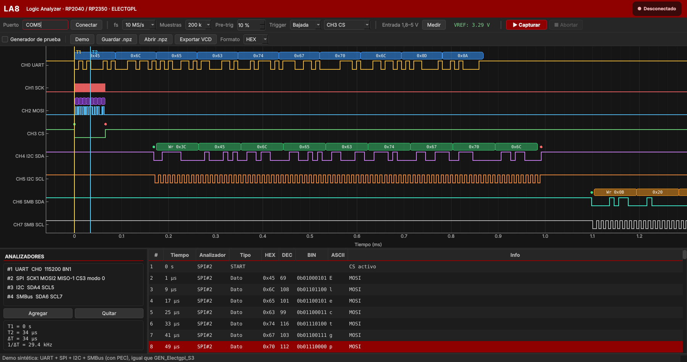
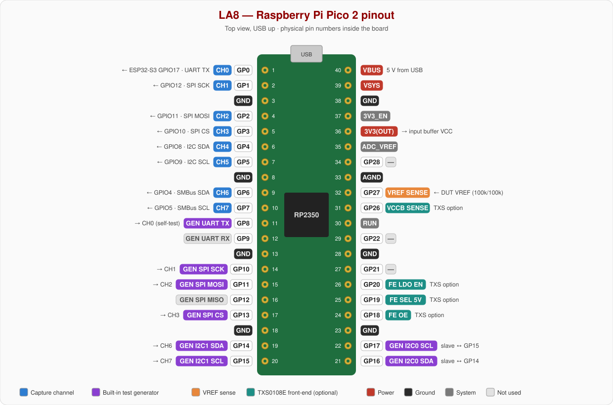
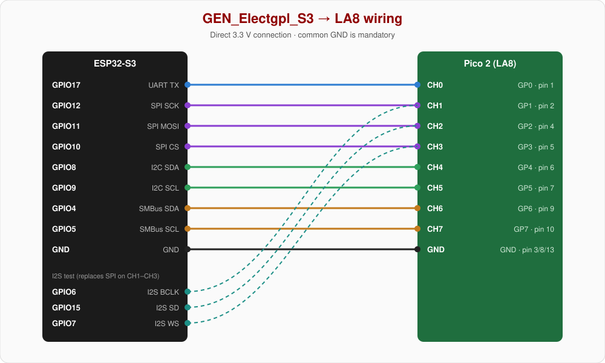
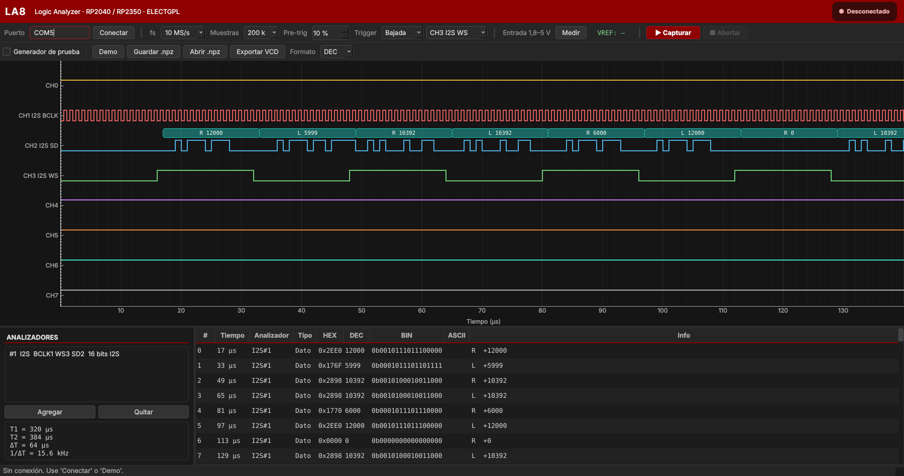

# LA8 — 8-Channel Logic Analyzer with RP2350 / RP2040

**LA8** turns a Raspberry Pi Pico 2 (RP2350) or Pico (RP2040) into an 8-channel logic analyzer, with a Saleae-style Python viewer for the PC.

- It decodes **UART, SPI, I2C, SMBus (with PEC) and I2S**.
- Decoded frames are listed in a table with **HEX / DEC / BIN / ASCII** columns.

It is an educational project from the ELECTGPL YouTube channel, built to show how the RP2xxx **PIO** and **DMA** work inside a real instrument. It is not meant to replace a commercial logic analyzer.



## Features

- **8 channels** sampled by a single PIO instruction: no skew between channels.
- **Sample rate:** up to **150 MS/s** on the RP2350 at its rated clock (f_sys).
- **Capture depth:** up to **~385 k samples** in SRAM (RP2350), held in a circular DMA buffer with no CPU involvement.
- **Trigger:** rising or falling edge with configurable pre-trigger, **aligned to the exact sample of the edge**.
- **Overflow detection:** the viewer is warned if any samples were lost.
- **Decoders:** UART · SPI (modes 0–3) · I2C · SMBus with PEC check · I2S (Philips and left-justified, 16/24/32 bits).
- **Viewer:**
  - Dark theme, cursors with ΔT and 1/ΔT, and click-to-jump from the frame table.
  - Channel labels generated automatically from the configured decoders.
  - VCD export (GTKWave / PulseView) and `.npz` save/load.
  - Built-in **Demo** mode that runs without hardware.
- **Test pattern generator** for ESP32-S3: it starts sending UART, SPI, I2C, SMBus and I2S frames as soon as it is powered, with no setup.

## Repository layout

| Path | Contents |
|---|---|
| `LA8_Electgpl/LA8_Electgpl.ino` | Pico / Pico 2 firmware (Arduino IDE, Earle Philhower core) |
| `la8_viewer.py` | PC viewer (Python + PySide6 + pyqtgraph) |
| `GEN_Electgpl_S3/GEN_Electgpl_S3.ino` | Free-running test pattern generator for ESP32-S3 |
| `docs/` | Pinout and wiring diagrams, screenshots |
| `electgpl_logo.png` | Viewer header logo (optional, same folder as the script) |

## Quick start

1. **Firmware:**
   - Install the [arduino-pico](https://github.com/earlephilhower/arduino-pico) core in the Arduino IDE.
   - Select *Raspberry Pi Pico 2* (or *Pico*) and flash `LA8_Electgpl.ino`.
   - Leave the default *CPU Speed*.
   - The IDE's "Low memory" warning is expected, because the capture buffer uses the RAM on purpose.
2. **Viewer:**
   - Run `pip install pyserial numpy pyqtgraph PySide6`.
   - Set `PORT` in the configuration block at the top of `la8_viewer.py` and run it, for example from Thonny.
   - Close the Arduino Serial Monitor first, because the COM port can only be opened by one program at a time.
3. **Test signals:** flash `GEN_Electgpl_S3.ino` on an ESP32-S3 (board *ESP32S3 Dev Module*), wire it as shown below and capture at 10 MS/s with a falling-edge trigger on CH3.

## Pinout



Physical pin numbers are not GPIO numbers. For example, physical pins 6 and 7 are **GP4 and GP5**, not GP6 and GP7.

## Wiring the ESP32-S3 test generator



| Signal | ESP32-S3 | Pico 2 GPIO | Pico 2 pin | LA8 channel |
|---|---|---|---|---|
| UART TX (115200 8N1, "Electgpl") | GPIO17 | GP0 | 1 | CH0 |
| SPI SCK (mode 0, 1 MHz) | GPIO12 | GP1 | 2 | CH1 |
| SPI MOSI | GPIO11 | GP2 | 4 | CH2 |
| SPI CS | GPIO10 | GP3 | 5 | CH3 |
| I2C SDA (100 kHz, addr 0x3C) | GPIO8 | GP4 | 6 | CH4 |
| I2C SCL | GPIO9 | GP5 | 7 | CH5 |
| SMBus SDA (100 kHz, addr 0x0B) | GPIO4 | GP6 | 9 | CH6 |
| SMBus SCL | GPIO5 | GP7 | 10 | CH7 |
| **GND (mandatory)** | GND | GND | 3, 8 or 13 | — |

- **The generator runs free:** it sends the full UART + SPI + I2C + SMBus cycle every 5 ms. I2C and SMBus are bit-banged, and the generator drives the slave ACK bits itself, so transactions appear complete with nothing attached.
- **Its I2C/SMBus outputs are push-pull:** do not connect them to a real I2C bus.
- **I2S** runs at 48 kHz, 16-bit stereo (Philips): L = 1 kHz sine, R = 2 kHz sine. It is generated by DMA in the background.
  - To test it, move CH1 ← GPIO6 (BCLK), CH2 ← GPIO15 (SD) and CH3 ← GPIO7 (WS).
  - In the viewer, add an I2S decoder (its defaults match this wiring) and capture at 25 MS/s.



## Input front-end

The RP2350 GPIOs should not be driven directly from arbitrary circuits. LA8 uses a unidirectional, high-impedance buffer powered from the Pico's 3V3(OUT):

| Buffer | Logic levels read | Input max | Notes |
|---|---|---|---|
| **SN74LV4T125** (recommended) | 1.8 V – 5 V (VIH 1.36 V) | 5.5 V | Lowered-threshold inputs; two ICs, standard '125 pinout |
| 74LVC125A / 74LVC244A | 2.5 V – 5 V (VIH 2.0 V) | 5.5 V | Same footprint as the LV4T125 ('125) or one 8-bit IC ('244) |
| 74HC244 (prototype only) | 3.3 V only (VIH ≈ 2.3 V) | VCC + 0.5 V | Not 5 V tolerant at 3.3 V supply |

Wiring rules, per channel:

- A **100 Ω** series resistor between the probe and the buffer input.
- A **100 kΩ** pull-down at the buffer input, so a disconnected channel reads 0.
- Optionally, a **33 Ω** series resistor between the buffer output and the GPIO.
- Tie all buffer OE pins to GND, so the outputs are always enabled.

Set `FRONTEND` in the viewer (`"LV4T125"`, `"LVC"`, `"HC244"`) to match the buffer you used. With `VREF_SENSE = True`, a 100k/100k divider from the probe connector's VREF terminal to GP27 lets the viewer warn when the DUT voltage is outside the buffer's range.

The earlier TXS0108E front-end, with a switchable 3.3 V / 5 V VCCB, is still supported via `FRONTEND_TXS0108 = 1` in the firmware and `FRONTEND = "TXS0108"` in the viewer.

## How the firmware works

```
 GP0..GP7 ──► PIO SM0 "capture" ──► RX FIFO (8 words) ──► DMA "data" ──► circular buffer in SRAM
              in pins, 8                                  │      ▲        (384 KB RP2350 /
              32-bit autopush                             │      │         192 KB RP2040)
                                                chain_to  ▼      │ re-trigger
                                                    DMA "control" (rewrites WRITE_ADDR)

 GP(trig) ──► PIO SM1 "trigger" ──► PIO IRQ 0 ──► CPU: counts post-trigger samples, stops,
              wait / wait / irq                    finds the exact edge in the captured data
```

1. **Sampling:**
   - A single PIO instruction, `in pins, 8`, wraps on itself, so fs = f_sys / clkdiv. The firmware reads back the divider actually programmed and reports the exact fs.
   - A 32-bit autopush packs 4 samples per word, oldest in the LSB. The buffer is therefore a chronological byte array: byte k is sample k, and its bit n is GPn.
2. **Circular buffer:**
   - When the "data" DMA channel fills the buffer, it chains to a "control" channel.
   - That channel writes the buffer start into the data channel's `AL2_WRITE_ADDR_TRIG` register, which both resets its write address and re-triggers it.
   - The result is a circular buffer of any size, without the 32 KB ring-wrap limit of the DMA.
3. **Trigger:**
   - A second state machine runs `wait` / `wait` / `irq` at the full f_sys.
   - The CPU arms it only once the pre-trigger samples have been captured, waits for the post-trigger samples, then stops both state machines and the DMA.
   - The exact edge is then searched backwards in the captured data, so the CPU's detection latency does not affect alignment.
4. **Overflow:** the `FDEBUG.RXSTALL` flag reports whether any samples were lost.
5. **Upload:** the window is sent over USB CDC in chronological order, in two chunks because the buffer is circular.

### USB protocol

Commands are ASCII lines terminated with `\n`. Lines starting with `#` are comments and are ignored by the viewer.

| Command | Response |
|---|---|
| `I` | `LA8 <chip> <f_sys> <max_samples> <base_pin>` |
| `C <fs> <n> <pre> <mode> <ch>` | `ARM` (if triggered) → `DATA <fs> <n> <trig_idx> <exact> <overflow>` + n raw bytes + `END` |
| `X` | aborts a capture → `ABORT` |
| `S` | `STAT <sel> <oe> <vccb_mV> <vref_mV>` |
| `G 0/1` | built-in test generator off/on |
| `V 0/3/5` | VCCB select (TXS0108E front-end only) |
| `H` | help |

Trigger mode: 0 = immediate, 1 = rising edge, 2 = falling edge.

## Self-test without an ESP32-S3

The Pico itself can generate test traffic on core 1. Enable *Generador de prueba* in the viewer and add these jumpers (all pins on the same Pico):

| Generator signal | From | To | Channel |
|---|---|---|---|
| UART1 TX 115200 8N1 | GP8 (pin 11) | GP0 (pin 1) | CH0 |
| SPI1 SCK | GP10 (pin 14) | GP1 (pin 2) | CH1 |
| SPI1 MOSI | GP11 (pin 15) | GP2 (pin 4) | CH2 |
| SPI CS | GP13 (pin 17) | GP3 (pin 5) | CH3 |
| I2C1 SDA (master) | GP14 (pin 19) | GP6 (pin 9) | CH6 |
| I2C1 SCL (master) | GP15 (pin 20) | GP7 (pin 10) | CH7 |
| I2C0 SDA (SMBus slave 0x0B) | GP16 (pin 21) | GP14 (pin 19) | — |
| I2C0 SCL (SMBus slave 0x0B) | GP17 (pin 22) | GP15 (pin 20) | — |

Add 4.7 kΩ pull-ups to 3V3 on SDA and SCL.

## Viewer configuration

All settings are at the top of `la8_viewer.py`, so it runs from Thonny with no command-line arguments.

| Setting | Purpose |
|---|---|
| `PORT` | Serial port of the Pico (`COM5`, `/dev/ttyACM0`) |
| `FRONTEND` | Input buffer used: `LV4T125`, `LVC`, `HC244` or `TXS0108` |
| `VREF_SENSE` | `True` only if GP27 has the VREF divider; otherwise the floating ADC would give false alarms |
| `DEFAULT_DECODERS` | Decoders loaded at startup |
| `CH_ALIAS` | Optional fixed channel names, e.g. `{7: "CH7 Ext trigger"}` |
| `THEME_*` | Theme colors |
| `LOGO_FILE` | Header logo |

## Known limitations

- **Depth:** limited by SRAM, since there is no streaming. 380 k samples at 10 MS/s is 38 ms.
- **Sample rate:** use at least **10× the fastest signal**. At 150 MS/s that means reliable decoding up to about 15 MHz, and about 25–30 MHz with short probes.
- **Slow edges:** the input buffers have no hysteresis. Very slow edges, such as I2C with weak pull-ups, may produce glitches.
- **Trigger:** a pulse narrower than 1/fs does not appear in the data, and the trigger is then flagged as approximate.
